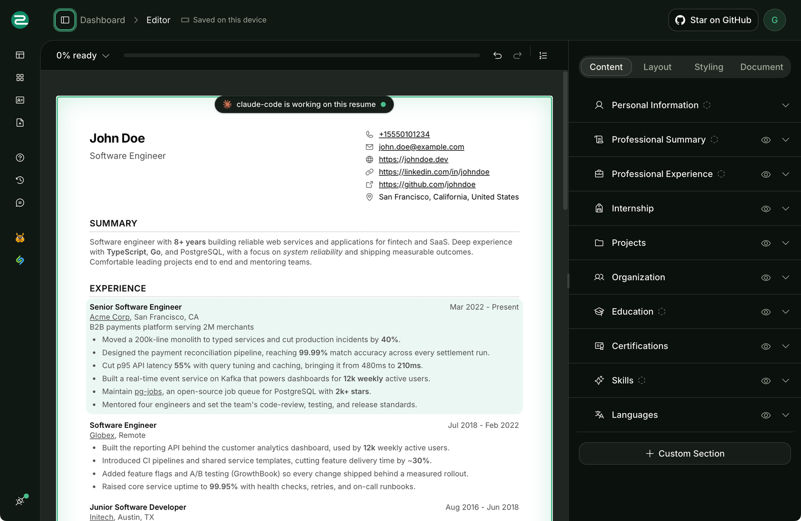
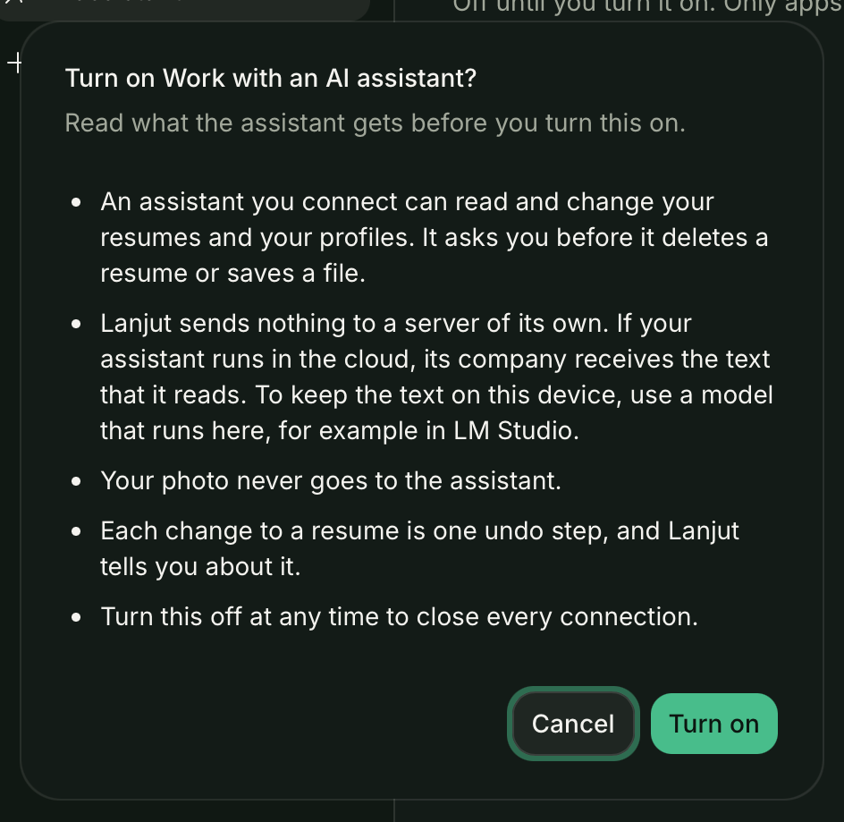
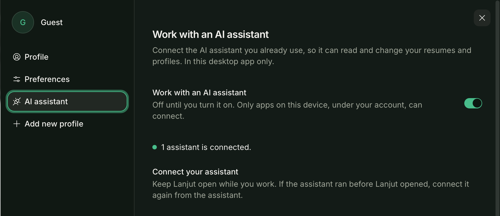

## Desktop app only

This feature is only in the desktop app. The web app at lanjut.org does not have it: Settings shows no AI assistant section, and no assistant can connect to the web app or read a résumé saved in your browser. The web app cannot run the local connection that an assistant needs.

To use it, [download Lanjut](/download) for macOS, Windows, or Linux. The résumés in your browser do not move to the desktop app by themselves. To bring them over, download a profile backup on the web app and import it in the desktop app.

## What it does

With the feature on, an assistant can work on your résumés:

- List, read, and open the résumés of your active profile.
- Change the words, line by line or as a whole.
- Change the look: the template, the font, the sizes, the spacing, the colors, and the contact icons.
- Change the order of the sections, and hide or show a section.
- Set a photo from an image file on your device, or remove the photo.
- Create a résumé, blank or from the sample, and copy one.
- Ask you to delete a résumé, or to save it as a PDF, a .docx, or a .txt file.

It can also work on your profiles:

- List your profiles, with their personal information and summary.
- Switch the active profile, create a profile, and change a profile.
- Move a résumé into another profile.

When the assistant changes a résumé, Lanjut opens it in the editor first, so you see each change. A chip at the top of the page names the assistant while it works, and the parts it changed keep a tint for 3 seconds.



## What stays private

The feature is off until you turn it on. While it is off, no assistant can connect to Lanjut.

When it is on:

- Lanjut still sends nothing to a server of its own.
- The connection is a local socket on your device, not a network port. Only apps that run under your account on this device can connect.
- The assistant you connect receives the text of the résumés it reads. If that assistant runs in the cloud, its company receives that text too. To keep the text on your device, use a model that runs on it, for example in LM Studio.
- Your photo never goes to the assistant. When it sets a photo, Lanjut reads the image file on your device, and the image does not go back to the assistant.

## Turn it on

1. Open the Lanjut desktop app.
2. Open the profile menu, then select Settings.
3. Select AI assistant.
4. Turn on Work with an AI assistant.
5. Read what the assistant gets, then select Turn on.



The page then says "On. No assistant is connected." When an assistant connects, it shows how many are connected, and a mark shows at the bottom of the sidebar. Select that mark to come back to this page.



## Connect your assistant

The AI assistant page has one row for each assistant. Each row gives a command or an entry with the full path of `lanjut-mcp`, the small helper that the assistant starts. Copy it from the app, because the path is different on each device.

Keep Lanjut open while you work. If the assistant started before Lanjut, connect it again from the assistant.

### Claude Code

1. Select Copy command in the Claude Code row.
2. Paste the command into a terminal and run it.
3. In Claude Code, run `/mcp` to check that `lanjut` is connected.

The command adds Lanjut for the folder you run it in. To use Lanjut from every folder, add `--scope user` after `claude mcp add`.

### Codex

1. Select Copy command in the Codex row.
2. Paste the command into a terminal and run it.
3. Start Codex again.

### Cursor

1. Select Open in Cursor.
2. Confirm the install in Cursor.

### LM Studio

1. Select Open in LM Studio.
2. Confirm the install in LM Studio.

A model in LM Studio runs on your device, so the résumé text stays on it.

### Claude Desktop

1. Select Copy entry in the Claude Desktop row.
2. In Claude, open Settings, then Developer, then Edit Config.
3. Add the `lanjut` entry under `mcpServers` in that file.
4. Restart Claude.

### Another assistant

If your assistant reads an `mcpServers` file, select Copy entry in the Another assistant row, and add the entry to that file. Ollama has no assistant of its own, so use an app that runs Ollama models and can connect to MCP servers.

## If macOS blocks the helper

macOS marks an app you download from the internet, and it stops an assistant from starting the helper inside it. When that happens, the AI assistant page shows "macOS blocks the assistant helper" with a command like this:

```sh
xattr -dr com.apple.quarantine /Applications/Lanjut.app
```

Copy the command from the page, because it holds the real place of your app. Run it once in Terminal, then open the AI assistant page again.

If macOS offers to move Lanjut to the Trash, do not accept. Select Done, then run the command.

## Ask for a change

Name the résumé and say what to change. Some requests that work well:

- "Make the bullets of my last job shorter."
- "Here is a job post. Adjust my summary for it."
- "Fix the grammar. Do not change the facts."
- "Translate this résumé to Indonesian."

Some requests for the look and the order:

- "Use the Ketat template and make the headings dark blue."
- "Put my skills first and hide the certifications."
- "Use the photo at /Users/me/Pictures/portrait.jpg."

The assistant uses the same settings as the editor, with the same limits. It cannot add a table, a column, or a new kind of section, so the résumé stays as easy for an ATS to read as before.

## Delete and save ask you first

An assistant never deletes a résumé by itself. When it asks, Lanjut shows its normal delete dialog, and only you can select Delete. If you select Cancel, the résumé stays.

When an assistant saves a résumé as a file, Lanjut opens its save dialog, and you pick the folder. If you close the dialog, Lanjut saves nothing.

The assistant waits two minutes for your answer.

## Undo a change

Each change that the assistant makes to a résumé is one undo step. When it lands, Lanjut shows a notice with an Undo button. You can also select Undo in the editor or press Cmd+Z (Ctrl+Z on Windows and Linux).

The Undo in the notice takes back the assistant's change only. If you edit the résumé after it, the notice goes away, so it never takes back your own words.

## When Lanjut refuses a change

Lanjut refuses a change, and tells the assistant why, in these cases:

- You changed the résumé after the assistant read it. The assistant reads it again, then writes.
- Lanjut cannot read the text, or a part of it has no field in its section. The résumé does not change, and the assistant gets the line to fix.
- A setting is outside what the editor allows, such as a color that is too light on white paper or a template that does not exist.
- The code view holds a text with an error that you are still writing. Lanjut keeps your text. Fix it, or switch back to the form.
- A newer version of Lanjut saved the résumé. Update Lanjut.

## Turn it off

Open Settings, then AI assistant, and turn off Work with an AI assistant. Lanjut closes every connection. The entry stays in your assistant, so you can turn the feature on again later and keep working.
