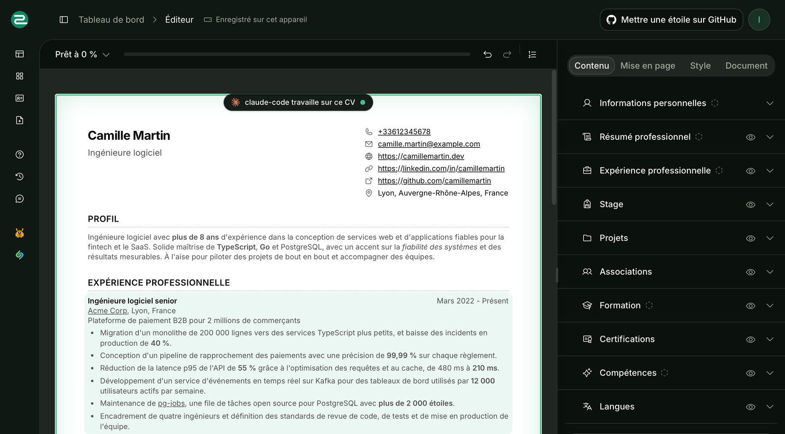
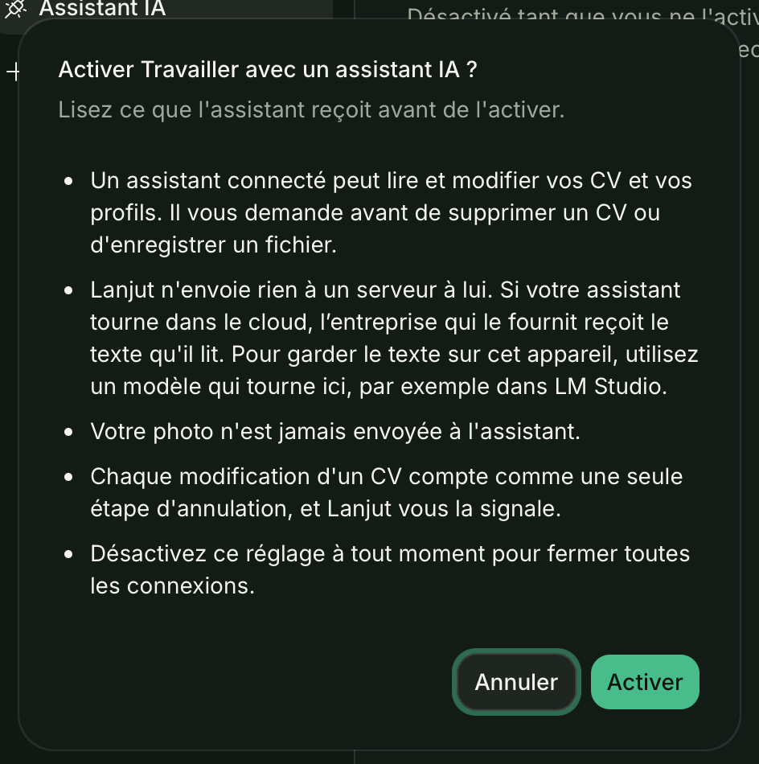
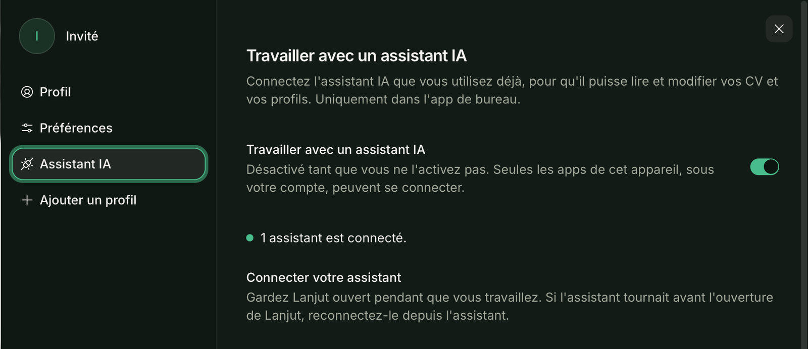

## Uniquement dans l'app de bureau

Cette fonction existe uniquement dans l'app de bureau. L'app web sur lanjut.org ne l'a pas : les Paramètres n'ont pas de section Assistant IA, et aucun assistant ne peut se connecter à l'app web ni lire un CV enregistré dans votre navigateur. L'app web ne peut pas faire tourner la connexion locale dont un assistant a besoin.

Pour l'utiliser, [téléchargez Lanjut](/download) pour macOS, Windows ou Linux. Les CV de votre navigateur ne passent pas tout seuls dans l'app de bureau. Pour les récupérer, téléchargez une sauvegarde de profil dans l'app web et importez-la dans l'app de bureau.

## Ce qu'elle fait

Une fois la fonction activée, un assistant peut travailler sur vos CV :

- Lister, lire et ouvrir les CV de votre profil actif.
- Modifier le texte, ligne par ligne ou en entier.
- Modifier l'apparence : le modèle, la police, les tailles, les espacements, les couleurs et les icônes de contact.
- Modifier l'ordre des sections, et masquer ou afficher une section.
- Ajouter une photo à partir d'un fichier image de votre appareil, ou retirer la photo.
- Créer un CV, vierge ou à partir de l'exemple, et copier un CV.
- Vous demander de supprimer un CV, ou de l'enregistrer en fichier PDF, .docx ou .txt.

Il peut aussi travailler sur vos profils :

- Lister vos profils, avec leurs informations personnelles et leur résumé.
- Changer de profil actif, créer un profil et modifier un profil.
- Déplacer un CV vers un autre profil.

Quand l'assistant modifie un CV, Lanjut l'ouvre d'abord dans l'éditeur, pour que vous voyiez chaque modification. Une pastille en haut de la page affiche le nom de l'assistant pendant qu'il travaille, et les parties qu'il a modifiées restent teintées pendant 3 secondes.



## Ce qui reste privé

La fonction est désactivée tant que vous ne l'activez pas. Tant qu'elle est désactivée, aucun assistant ne peut se connecter à Lanjut.

Quand elle est activée :

- Lanjut n'envoie toujours rien à un serveur à lui.
- La connexion est un socket local sur votre appareil, pas un port réseau. Seules les apps qui tournent sous votre compte sur cet appareil peuvent se connecter.
- L'assistant que vous connectez reçoit le texte des CV qu'il lit. Si cet assistant tourne dans le cloud, son éditeur reçoit aussi ce texte. Pour garder le texte sur votre appareil, utilisez un modèle qui tourne dessus, par exemple dans LM Studio.
- Votre photo n'est jamais envoyée à l'assistant. Quand il ajoute une photo, Lanjut lit le fichier image sur votre appareil, et l'image ne repart pas vers l'assistant.

## L'activer

1. Ouvrez l'app de bureau Lanjut.
2. Ouvrez le menu du profil, puis sélectionnez Paramètres.
3. Sélectionnez Assistant IA.
4. Activez Travailler avec un assistant IA.
5. Lisez ce que l'assistant reçoit, puis sélectionnez Activer.



La page affiche ensuite « Activé. Aucun assistant n'est connecté. » Quand un assistant se connecte, elle indique combien sont connectés, et un repère apparaît en bas de la barre latérale. Sélectionnez ce repère pour revenir à cette page.



## Connecter votre assistant

La page Assistant IA a une ligne par assistant. Chaque ligne donne une commande ou une entrée avec le chemin complet de `lanjut-mcp`, le petit outil que lance l'assistant. Copiez-la depuis l'app, car le chemin est différent sur chaque appareil.

Gardez Lanjut ouvert pendant que vous travaillez. Si l'assistant a démarré avant Lanjut, reconnectez-le depuis l'assistant.

### Claude Code

1. Sélectionnez Copier la commande dans la ligne Claude Code.
2. Collez la commande dans un terminal et exécutez-la.
3. Dans Claude Code, exécutez `/mcp` pour vérifier que `lanjut` est connecté.

La commande ajoute Lanjut pour le dossier dans lequel vous l'exécutez. Pour utiliser Lanjut depuis tous les dossiers, ajoutez `--scope user` après `claude mcp add`.

### Codex

1. Sélectionnez Copier la commande dans la ligne Codex.
2. Collez la commande dans un terminal et exécutez-la.
3. Redémarrez Codex.

### Cursor

1. Sélectionnez Ouvrir dans Cursor.
2. Confirmez l'installation dans Cursor.

### LM Studio

1. Sélectionnez Ouvrir dans LM Studio.
2. Confirmez l'installation dans LM Studio.

Un modèle dans LM Studio tourne sur votre appareil, donc le texte du CV y reste.

### Claude Desktop

1. Sélectionnez Copier l'entrée dans la ligne Claude Desktop.
2. Dans Claude, ouvrez Settings, puis Developer, puis Edit Config.
3. Ajoutez l'entrée `lanjut` sous `mcpServers` dans ce fichier.
4. Redémarrez Claude.

### Un autre assistant

Si votre assistant lit un fichier `mcpServers`, sélectionnez Copier l'entrée dans la ligne Un autre assistant, et ajoutez l'entrée à ce fichier. Ollama n'a pas d'assistant à lui, donc utilisez une app qui fait tourner des modèles Ollama et qui peut se connecter à des serveurs MCP.

## Si macOS bloque l'outil

macOS marque une app que vous téléchargez depuis Internet, et empêche un assistant de lancer l'outil qu'elle contient. Dans ce cas, la page Assistant IA affiche « macOS bloque l'outil de l'assistant » avec une commande comme celle-ci :

```sh
xattr -dr com.apple.quarantine /Applications/Lanjut.app
```

Copiez la commande depuis la page, car elle contient l'emplacement réel de votre app. Exécutez-la une fois dans le Terminal, puis rouvrez la page Assistant IA.

Si macOS propose de placer Lanjut dans la corbeille, refusez. Sélectionnez Terminé, puis exécutez la commande.

## Demander une modification

Nommez le CV et dites ce qu'il faut changer. Quelques demandes qui fonctionnent bien :

- « Raccourcis les puces de mon dernier poste. »
- « Voici une offre d'emploi. Adapte ma synthèse à cette offre. »
- « Corrige les fautes. Ne change pas les faits. »
- « Traduis ce CV en anglais. »

Quelques demandes pour l'apparence et l'ordre :

- « Utilise le modèle Ketat et mets les titres en bleu foncé. »
- « Mets mes compétences en premier et masque les certifications. »
- « Utilise la photo /Users/me/Pictures/portrait.jpg. »

L'assistant utilise les mêmes réglages que l'éditeur, avec les mêmes limites. Il ne peut pas ajouter de tableau, de colonne ni de nouveau type de section, donc le CV reste aussi facile à lire pour un ATS qu'avant.

## La suppression et l'enregistrement vous demandent d'abord

Un assistant ne supprime jamais un CV tout seul. Quand il le demande, Lanjut affiche sa fenêtre de suppression habituelle, et vous seul pouvez sélectionner Supprimer. Si vous sélectionnez Annuler, le CV reste.

Quand un assistant enregistre un CV en fichier, Lanjut ouvre sa fenêtre d'enregistrement, et vous choisissez le dossier. Si vous fermez la fenêtre, Lanjut n'enregistre rien.

L'assistant attend votre réponse pendant deux minutes.

## Annuler une modification

Chaque modification que l'assistant fait sur un CV compte comme une seule étape d'annulation. Quand elle arrive, Lanjut affiche une notification avec un bouton Annuler. Vous pouvez aussi sélectionner Annuler dans l'éditeur ou appuyer sur Cmd+Z (Ctrl+Z sous Windows et Linux).

Le bouton Annuler de la notification annule uniquement la modification de l'assistant. Si vous modifiez le CV après elle, la notification disparaît, donc elle n'annule jamais vos propres mots.

## Quand Lanjut refuse une modification

Lanjut refuse une modification, et dit pourquoi à l'assistant, dans ces cas :

- Vous avez modifié le CV après que l'assistant l'a lu. L'assistant le relit, puis écrit.
- Lanjut ne peut pas lire le texte, ou une partie du texte n'a pas de champ dans sa section. Le CV ne change pas, et l'assistant reçoit la ligne à corriger.
- Un réglage sort de ce que l'éditeur autorise, par exemple une couleur trop claire sur du papier blanc ou un modèle qui n'existe pas.
- La vue Code contient un texte avec une erreur que vous êtes encore en train d'écrire. Lanjut garde votre texte. Corrigez-le, ou revenez au formulaire.
- Une version plus récente de Lanjut a enregistré le CV. Mettez Lanjut à jour.

## La désactiver

Ouvrez Paramètres, puis Assistant IA, et désactivez Travailler avec un assistant IA. Lanjut ferme toutes les connexions. L'entrée reste dans votre assistant, donc vous pouvez réactiver la fonction plus tard et continuer à travailler.
