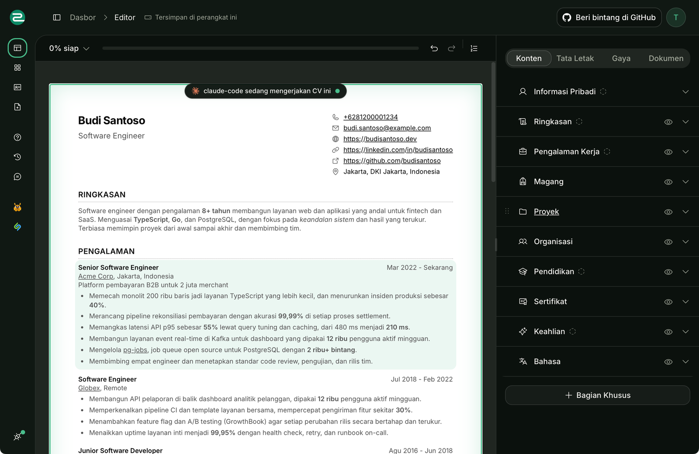
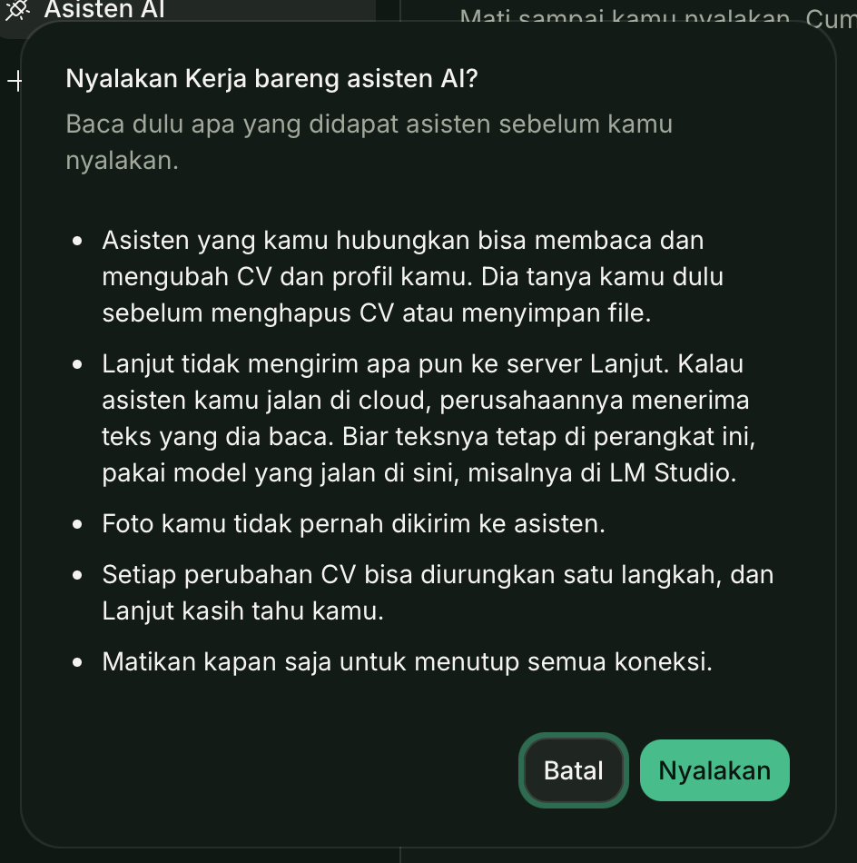
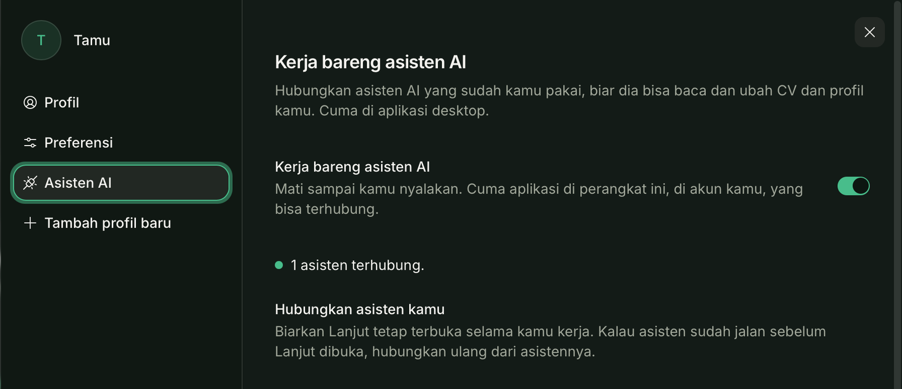

## Cuma di aplikasi desktop

Fitur ini cuma ada di aplikasi desktop. Web app di lanjut.org nggak punya fitur ini: Pengaturan nggak menampilkan bagian Asisten AI, dan nggak ada asisten yang bisa terhubung ke web app atau membaca CV yang tersimpan di browser kamu. Web app nggak bisa menjalankan koneksi lokal yang dibutuhkan asisten.

Untuk memakainya, [unduh Lanjut](/download) untuk macOS, Windows, atau Linux. CV di browser kamu nggak pindah ke aplikasi desktop dengan sendirinya. Untuk memindahkannya, unduh cadangan profil di web app, lalu impor di aplikasi desktop.

## Apa yang bisa dilakukan

Kalau fitur ini nyala, asisten bisa mengerjakan CV kamu:

- Melihat daftar, membaca, dan membuka CV di profil aktif kamu.
- Mengubah kata-katanya, per baris atau sekaligus.
- Mengubah tampilannya: template, font, ukuran, jarak, warna, dan ikon kontak.
- Mengubah urutan bagian, dan menyembunyikan atau menampilkan bagian.
- Memasang foto dari file gambar di perangkat kamu, atau menghapus fotonya.
- Membuat CV baru, kosong atau dari contoh, dan menyalin CV.
- Minta izin kamu untuk menghapus CV, atau menyimpannya sebagai file PDF, .docx, atau .txt.

Dia juga bisa mengerjakan profil kamu:

- Melihat daftar profil, lengkap dengan informasi pribadi dan ringkasannya.
- Mengganti profil aktif, membuat profil, dan mengubah profil.
- Memindahkan CV ke profil lain.

Saat asisten mengubah CV, Lanjut membukanya dulu di editor, jadi kamu lihat setiap perubahannya. Selama asisten bekerja, ada chip di atas halaman yang menunjukkan nama asistennya, dan bagian yang dia ubah diberi warna selama 3 detik.



## Apa yang tetap privat

Fitur ini mati sampai kamu nyalakan. Selama mati, nggak ada asisten yang bisa terhubung ke Lanjut.

Kalau nyala:

- Lanjut tetap nggak mengirim apa pun ke server Lanjut.
- Koneksinya lewat socket lokal di perangkat kamu, bukan port jaringan. Cuma aplikasi yang jalan di akun kamu, di perangkat ini, yang bisa terhubung.
- Asisten yang kamu hubungkan menerima teks CV yang dia baca. Kalau asistennya jalan di cloud, perusahaannya juga menerima teks itu. Biar teksnya tetap di perangkat kamu, pakai model yang jalan di sini, misalnya di LM Studio.
- Foto kamu nggak pernah dikirim ke asisten. Saat dia memasang foto, Lanjut membaca file gambarnya di perangkat kamu, dan gambarnya nggak dikirim balik ke asisten.

## Nyalakan fiturnya

1. Buka aplikasi desktop Lanjut.
2. Buka menu profil, lalu pilih Pengaturan.
3. Pilih Asisten AI.
4. Nyalakan Kerja bareng asisten AI.
5. Baca apa yang didapat asisten, lalu pilih Nyalakan.



Halamannya lalu bilang "Nyala. Belum ada asisten yang terhubung." Begitu ada asisten yang terhubung, halaman ini menunjukkan jumlahnya, dan muncul tanda di bagian bawah sidebar. Pilih tanda itu untuk balik ke halaman ini.



## Hubungkan asisten kamu

Halaman Asisten AI punya satu baris untuk tiap asisten. Tiap baris berisi perintah atau entri dengan path lengkap `lanjut-mcp`, program kecil yang dijalankan asisten. Salin dari aplikasinya, karena path-nya beda di tiap perangkat.

Biarkan Lanjut tetap terbuka selama kamu kerja. Kalau asistennya sudah jalan sebelum Lanjut dibuka, hubungkan ulang dari asistennya.

### Claude Code

1. Pilih Salin perintah di baris Claude Code.
2. Tempel perintahnya di terminal, lalu jalankan.
3. Di Claude Code, jalankan `/mcp` untuk cek apakah `lanjut` sudah terhubung.

Perintah ini menambahkan Lanjut untuk folder tempat kamu menjalankannya. Biar Lanjut bisa dipakai dari folder mana pun, tambahkan `--scope user` setelah `claude mcp add`.

### Codex

1. Pilih Salin perintah di baris Codex.
2. Tempel perintahnya di terminal, lalu jalankan.
3. Buka ulang Codex.

### Cursor

1. Pilih Buka di Cursor.
2. Konfirmasi pemasangannya di Cursor.

### LM Studio

1. Pilih Buka di LM Studio.
2. Konfirmasi pemasangannya di LM Studio.

Model di LM Studio jalan di perangkat kamu, jadi teks CV kamu tetap di sana.

### Claude Desktop

1. Pilih Salin entri di baris Claude Desktop.
2. Di Claude, buka Settings, lalu Developer, lalu Edit Config.
3. Tambahkan entri `lanjut` di bawah `mcpServers` di file itu.
4. Mulai ulang Claude.

### Asisten lain

Kalau asisten kamu membaca file `mcpServers`, pilih Salin entri di baris Asisten lain, lalu tambahkan entrinya ke file itu. Ollama nggak punya asisten sendiri, jadi pakai aplikasi yang menjalankan model Ollama dan bisa terhubung ke server MCP.

## Kalau macOS memblokir pembantu asisten

macOS menandai aplikasi yang kamu unduh dari internet, dan tanda itu bikin asisten nggak bisa menjalankan pembantu di dalamnya. Kalau ini terjadi, halaman Asisten AI menampilkan "macOS memblokir pembantu asisten" dengan perintah seperti ini:

```sh
xattr -dr com.apple.quarantine /Applications/Lanjut.app
```

Salin perintahnya dari halaman itu, karena isinya lokasi asli aplikasi kamu. Jalankan sekali di Terminal, lalu buka lagi halaman Asisten AI.

Kalau macOS menawarkan untuk memindahkan Lanjut ke Sampah, jangan setujui. Pilih Selesai, lalu jalankan perintahnya.

## Minta perubahan

Sebut CV-nya dan bilang apa yang mau diubah. Beberapa permintaan yang hasilnya bagus:

- "Pendekkan poin-poin di pekerjaan terakhirku."
- "Ini lowongannya. Sesuaikan ringkasanku dengan lowongan ini."
- "Perbaiki tata bahasanya. Jangan ubah faktanya."
- "Terjemahkan CV ini ke bahasa Inggris."

Beberapa permintaan untuk tampilan dan urutan:

- "Pakai template Ketat, dan bikin judul bagiannya biru tua."
- "Taruh keahlian paling atas, dan sembunyikan sertifikat."
- "Pakai foto di /Users/aku/Pictures/foto.jpg."

Asisten memakai pengaturan yang sama dengan editor, dengan batas yang sama. Dia nggak bisa menambahkan tabel, kolom, atau jenis bagian baru, jadi CV kamu tetap gampang dibaca ATS seperti sebelumnya.

## Hapus dan simpan selalu tanya kamu dulu

Asisten nggak pernah menghapus CV sendiri. Saat dia minta, Lanjut menampilkan dialog hapus yang biasa, dan cuma kamu yang bisa pilih Hapus. Kalau kamu pilih Batal, CV-nya tetap ada.

Saat asisten menyimpan CV sebagai file, Lanjut membuka dialog simpan, dan kamu yang pilih foldernya. Kalau kamu tutup dialognya, Lanjut nggak menyimpan apa-apa.

Asisten menunggu jawaban kamu selama dua menit.

## Urungkan perubahan

Setiap perubahan asisten pada CV adalah satu langkah urungkan. Begitu perubahannya masuk, Lanjut menampilkan pemberitahuan dengan tombol Urungkan. Kamu juga bisa pilih Urungkan di editor, atau tekan Cmd+Z (Ctrl+Z di Windows dan Linux).

Tombol Urungkan di pemberitahuan cuma membatalkan perubahan dari asisten. Kalau kamu mengedit CV setelahnya, pemberitahuannya hilang, jadi tombol itu nggak pernah membatalkan tulisanmu sendiri.

## Kalau Lanjut menolak perubahan

Lanjut menolak perubahan, dan kasih tahu asisten alasannya, dalam kasus berikut:

- Kamu mengubah CV setelah asisten membacanya. Asisten membaca ulang, lalu menulis.
- Lanjut nggak bisa membaca teksnya, atau ada bagian teks yang nggak punya kolom di bagiannya. CV kamu nggak berubah, dan asisten dapat baris yang perlu diperbaiki.
- Pengaturannya di luar batas editor, misalnya warna yang terlalu terang di kertas putih, atau template yang nggak ada.
- Tampilan kode berisi teks dengan error yang masih kamu tulis. Lanjut menyimpan teks kamu. Perbaiki teksnya, atau balik ke Form.
- Versi Lanjut yang lebih baru sudah menyimpan CV ini. Perbarui Lanjut.

## Matikan fiturnya

Buka Pengaturan, lalu Asisten AI, dan matikan Kerja bareng asisten AI. Lanjut menutup semua koneksi. Entrinya tetap ada di asisten kamu, jadi kamu bisa nyalakan lagi nanti dan lanjut kerja.
